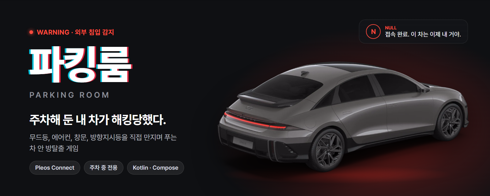
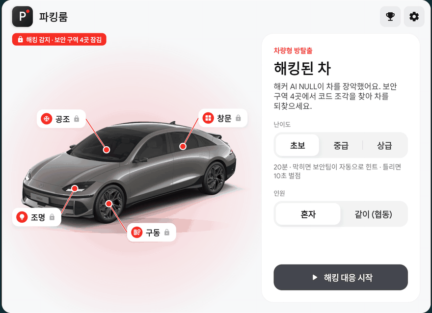
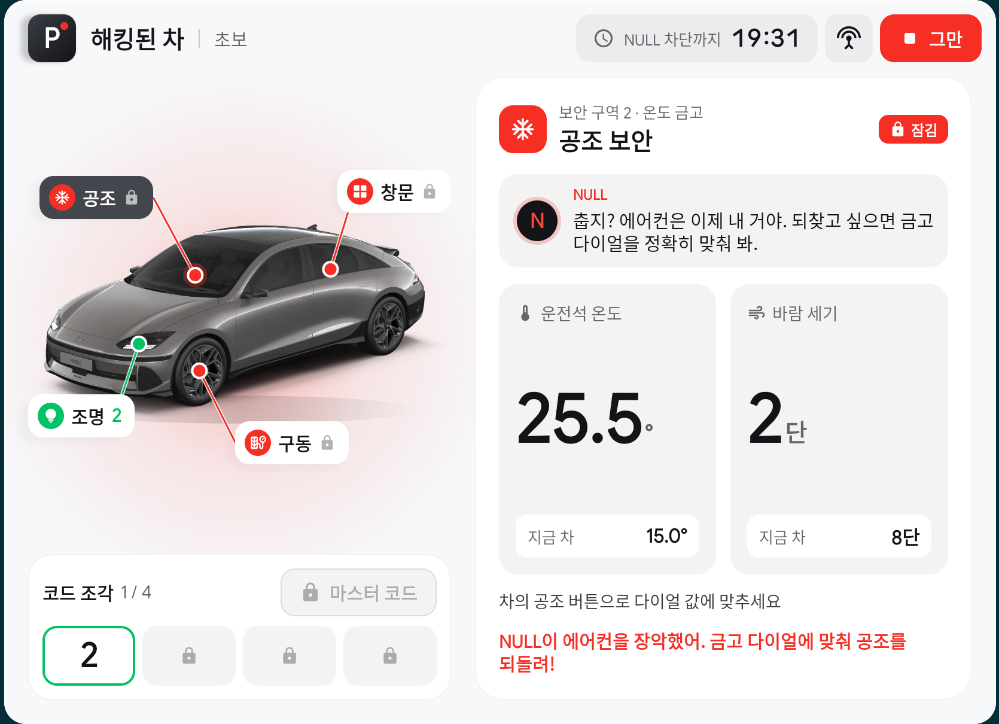
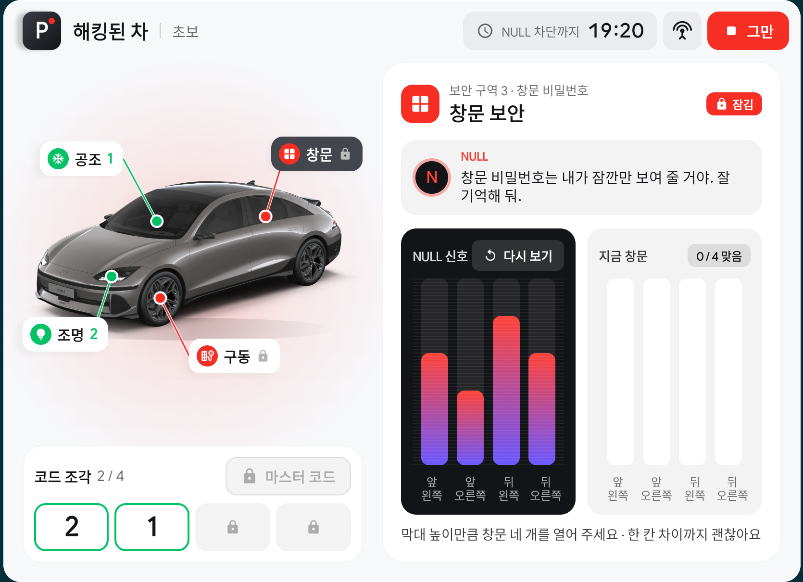
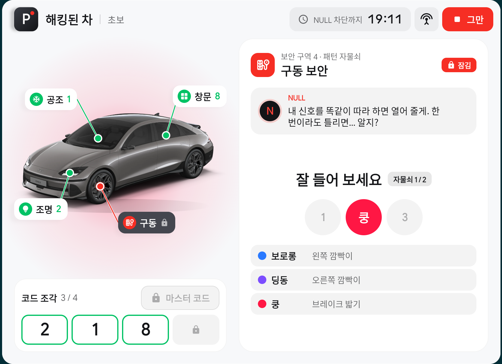
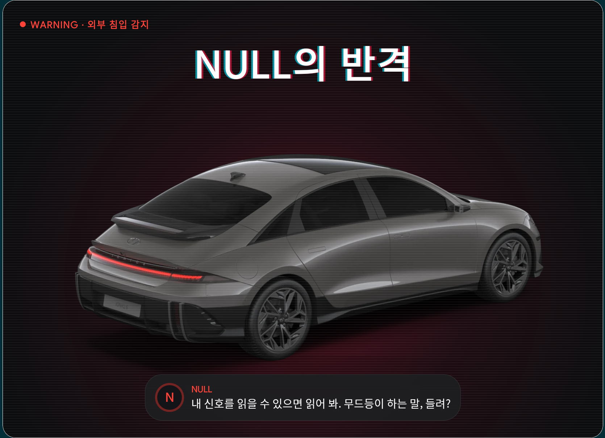
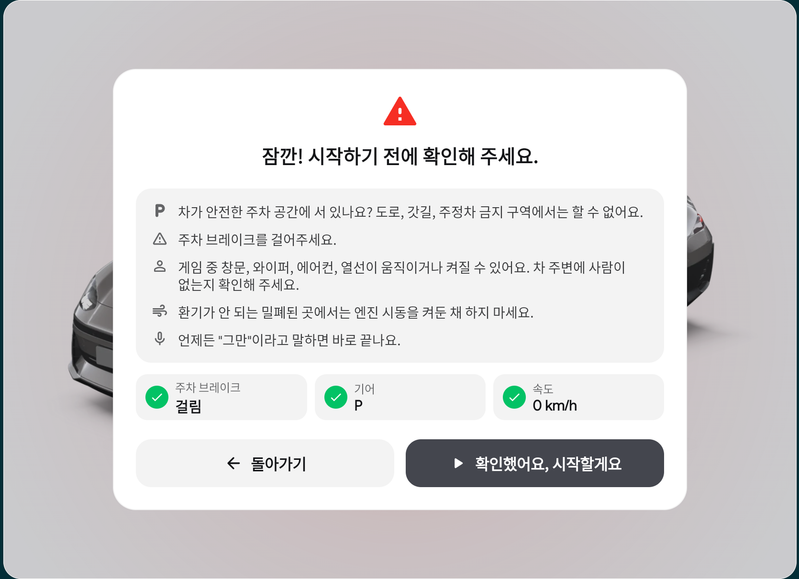
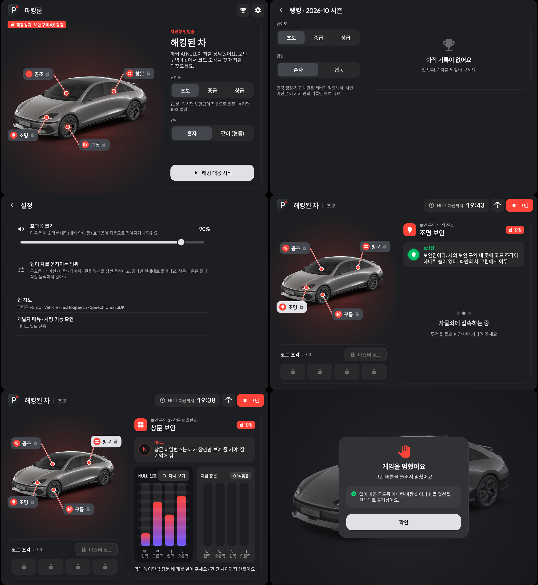

<p align="center">
  
</p>

<p align="center">
  
  
  
  
  
</p>

<p align="center">
  <a href="apk/TodaysStudio_ParkingRoom_release.apk"><b>APK 받기</b></a>
  &nbsp;·&nbsp;
  <a href="#바로-해-보기"><b>설치 방법</b></a>
  &nbsp;·&nbsp;
  <a href="#안전이-먼저"><b>안전 설계</b></a>
</p>

<br>

<p align="center">
  
</p>

<br>

충전기 꽂아 두고 30분, 학원 앞에서 20분. 시동은 켜져 있는데 차는 서 있는 시간에 할 수 있는 게임을 만들었습니다.

해커 AI **NULL**이 차를 장악하고 무드등을 빨갛게 깜빡이고, 찬바람을 틀고, 와이퍼를 흔듭니다. 화면만 누르는 게 아니라 **차의 에어컨 버튼, 창문 스위치, 방향지시등, 브레이크로 자물쇠를 풀어** 시간 안에 차를 되찾으면 됩니다. 혼자 해도 되고, 가족이 각자 자리에서 같이 풀어도 됩니다.

<br>

## 자물쇠는 차에 있어요

<table>
  <tr>
    <td width="50%" valign="top">
      <br>
      <b>조명 보안</b><br>
      무드등이 여러 색으로 깜빡여요. “NULL은 바다색을 싫어해” 같은 단서를 보고, 그 색이 몇 번 깜빡였는지 맞히세요.
    </td>
    <td width="50%" valign="top">
      <br>
      <b>공조 보안</b><br>
      NULL이 찬바람을 세게 틀어 놨어요. 금고 다이얼에 나온 온도와 바람 세기를 진짜 공조 버튼으로 맞춰야 열려요.
    </td>
  </tr>
  <tr>
    <td width="50%" valign="top">
      <br>
      <b>창문 보안</b><br>
      막대 네 개가 잠깐 나왔다 사라져요. 막대 높이만큼 창문 네 개를 직접 열면 돼요. 같이 타고 있으면 각자 자기 창문을 맡아요.
    </td>
    <td width="50%" valign="top">
      <br>
      <b>구동 보안</b><br>
      왼쪽, 오른쪽, 브레이크 신호를 듣고 방향지시등과 브레이크 페달로 똑같이 따라 하세요. 갈수록 길어져요.
    </td>
  </tr>
</table>

네 곳에서 코드 조각을 모아 **마스터 코드**를 넣으면 빨간빛이 빠지고, 청록색 무드등과 따뜻한 바람, 와이퍼 인사로 차가 돌아와요. 틀리면 시간이 깎이고 **NULL의 반격**이 들어오니 조심하세요.

<table>
  <tr>
    <td width="33%"><br><sub>해킹 시작. 화면이 지직거리고 무드등이 빨갛게</sub></td>
    <td width="33%"><br><sub>틀리면 NULL의 반격</sub></td>
    <td width="33%"><br><sub>탈출 성공. 기록, 이번 달 순위, 공유</sub></td>
  </tr>
</table>

<br>

## 안전이 먼저

<table>
  <tr>
    <td width="50%"></td>
    <td width="50%"></td>
  </tr>
</table>

- **주차 중에만 켜져요.** 주차 브레이크, 기어 P, 속도 0을 앱이 직접 확인하고 나서야 시작 버튼이 눌려요.
- **언제든 바로 멈춰요.** 게임 중에 기어를 바꾸거나 브레이크를 풀면 0.2~0.4초 안에 멈춰요. “그만”이라고 말하거나 그만 버튼을 눌러도 돼요.
- **원래대로 돌려놔요.** 앱이 바꾼 무드등, 에어컨, 바람, 와이퍼, 핸들 열선은 끝나거나 멈추면 시작 전 값으로 돌아가요.
- **창문과 문은 안 건드려요.** 창문은 사람이 직접 열고 닫고, 앱은 창문을 닫거나 문을 잠그지 않아요. 깜빡임 속도, 찬바람 시간, 소리 크기에도 상한을 뒀어요.

<br>

## 다크 모드도 돼요

<p align="center">
  
</p>

화면은 Pleos 디자인 가이드의 공식 디자인 에셋 수치에 맞춰 만들어서 순정 앱 옆에 있어도 어색하지 않아요. 게임 화면의 차 뒤 빛은 실제 무드등 색을 그대로 따라가요.

<br>

## 바로 해 보기

Pleos Playground 에뮬레이터 기준이에요.

**1. 설치**

```bash
adb install -r -g apk/TodaysStudio_ParkingRoom_release.apk
```

**2. Virtual Console에서 주차 상태 만들기**

Motion › Gear Selection을 **P**로, Safety › Telltales › **Parking Brake**를 **On**으로 바꿔 주세요.

**3. 파킹룸 실행**

난이도와 인원을 고르고 **해킹 대응 시작**을 누르면 돼요. 처음 뜨는 속도 권한은 허용해 주세요.

> 에뮬레이터는 주차 브레이크 값이 항상 꺼짐으로 나와서, 계기판 경고등(Telltale)으로 확인해요. 그래서 2번에서 Telltale을 켜야 해요.

<br>

<details>
<summary><b>게임 중 차 조작 (Virtual Console)</b></summary>

<br>

| 구역 | 조작 |
|:--|:--|
| 조명 보안 | 조작 없음. 무드등을 보고 숫자를 말하거나 키패드로 입력 |
| 공조 보안 | Climate › Driver Temperature, Fan Speed |
| 창문 보안 | Body › Window FL, FR, RL, RR (10%가 한 칸) |
| 구동 보안 | Body › Turn Signal Left / Right, Motion › Brake |
| 중단 테스트 | Gear Selection을 D로, 또는 Parking Brake를 Off |

음성으로 하려면 에뮬레이터 Extended controls › Microphone › *Virtual microphone uses host audio input*을 켜 주세요. 말 대신 화면 버튼으로도 전부 할 수 있어요.

</details>

<details>
<summary><b>난이도</b></summary>

<br>

| | 초보 | 중급 | 상급 |
|:--|:--:|:--:|:--:|
| 제한 시간 | 20분 | 15분 | 12분 |
| 보안팀 힌트 | 막히면 자동 | 3번 | 1번 |
| 색 신호 | 색 2개 | 색 3개 | 색 4개 |
| 온도 금고 | 한 번 | NULL이 1번 바꿈 | NULL이 2번 바꿈 |
| 창문 비밀번호 | 한 칸 차이 허용 | 정확히 | 정확히, 막대 1초 |
| 패턴 자물쇠 | 3 → 4 | 3 → 4 → 5 | 4 → 5 → 6 |
| 마스터 코드 | 순서대로 | 순서대로 | 거꾸로 |
| 오답 벌점 | 10초 | 20초 | 30초 |

단서는 판마다 새로 정해져서 같은 난이도도 매번 답이 달라요. 힌트는 무전 버튼을 누르거나 “힌트”라고 말하면 보안팀이 알려 줘요.

</details>

<details>
<summary><b>쓰는 SDK와 권한</b></summary>

<br>

- Pleos **Vehicle SDK 2.3.2**: 무드등, 방향지시등, 공조, 창문 위치(읽기만), 와이퍼, 브레이크 페달, 핸들 열선, 주차 브레이크 경고등
- Pleos **TextToSpeech 3.3.1 / SpeechToText 3.3.1**: NULL과 보안팀 목소리, 음성 명령
- **AAOS Car API**: 기어, 속도, 주행 규제 확인

| 권한 | 쓰는 곳 |
|:--|:--|
| CAR_POWERTRAIN, CAR_SPEED | 기어 P, 속도 0 확인 |
| CAR_SAFETY, PRIVATE_CAR_SAFETY | 주차 브레이크 경고등 |
| CAR_DRIVE | 브레이크 페달 |
| CAR_LIGHTS, CONTROL_CAR_LIGHTS | 방향지시등 읽기, 무드등 연출 |
| CAR_WINDOWS, CONTROL_CAR_WINDOWS | 창문 위치 읽기, 와이퍼 연출 (창문은 안 움직임) |
| CAR_CLIMATE, CONTROL_CAR_CLIMATE | 공조 온도와 바람, 핸들 열선 |
| TTS_SERVICE, STT_SERVICE | 음성 |

</details>

<details>
<summary><b>직접 빌드하기</b></summary>

<br>

Android Studio, JDK 17, Android SDK 35가 필요해요. Pleos SDK는 `settings.gradle.kts`에 등록된 Pleos Playground 메이븐 저장소에서 자동으로 받아요.

```bash
./gradlew :app:assembleDebug      # 디버그 (차량 기능 확인용 개발자 메뉴 포함)
./gradlew :app:assembleRelease    # 릴리스 (루트에 keystore.properties 필요)
```

</details>

<details>
<summary><b>코드 구조</b></summary>

<br>

```
app/src/main/
├─ assets/scenarios/hacked_car.json   대사, 난이도, 연출 순서
└─ java/com/parkingroom/app/
   ├─ car/       SafetyMonitor(주차 감시·즉시 중단), CarHub(설정 저장·복구), 차 읽기/쓰기
   ├─ engine/    PuzzleEngine(자물쇠 판정), EffectEngine(4D 연출, 안전 상한 내장)
   ├─ voice/     TTS 두 화자, STT 명령어
   ├─ audio/     효과음 합성, 오디오 포커스
   ├─ game/      게임 진행, 화면 전환
   ├─ data/      기기 안 기록, 월별 랭킹
   └─ ui/        Compose 화면 (Pleos 디자인 토큰)
```

새 테마는 시나리오 JSON만 추가하면 같은 엔진으로 돌아가요.

</details>

<details>
<summary><b>자동 플레이 테스트</b></summary>

<br>

Virtual Console HTTP API로 차 값을 바꿔 가며 처음부터 끝까지 자동으로 플레이해요.

```bash
adb forward tcp:8088 tcp:8088
python -X utf8 tools/game_test/e2e.py <결과폴더>
```

주행 상태에서 시작이 막히는지, 초보와 상급을 끝까지 풀 수 있는지, 오답 벌점, 즉시 중단, 끝난 뒤 차 상태가 처음과 같은지 확인해요.

</details>

<br>

<p align="center">
  <sub>© Today's Studio · 차 렌더와 디자인 수치는 Pleos 디자인 가이드 공식 에셋을 Pleos Connect 앱 제작 목적으로 사용했습니다.</sub>
</p>
