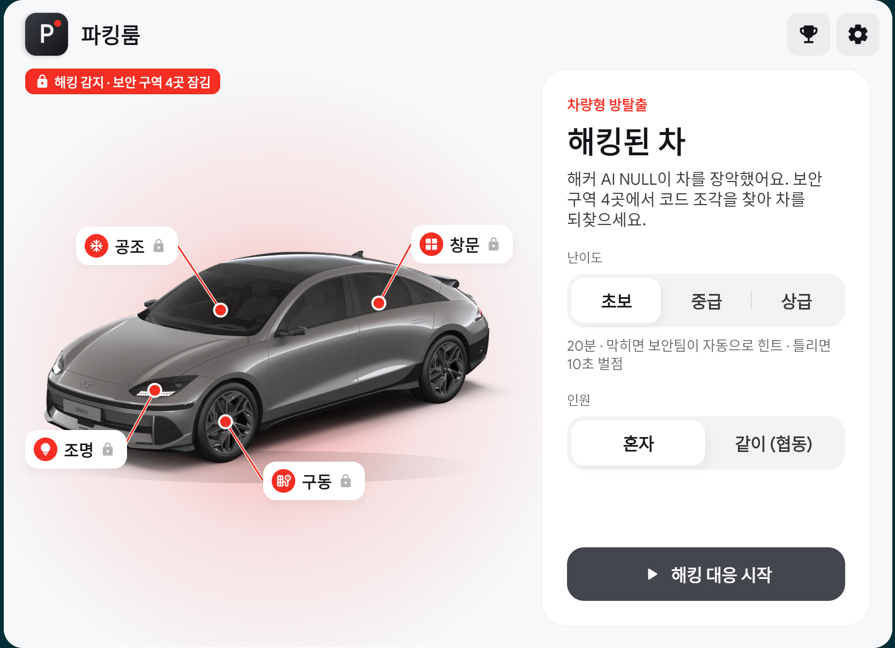
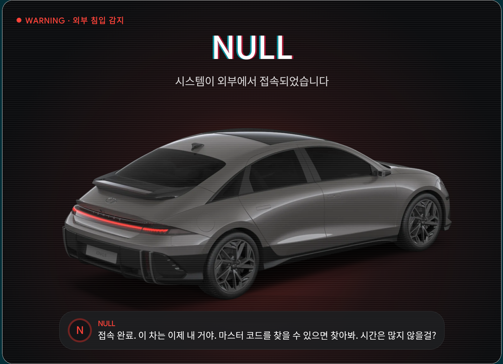
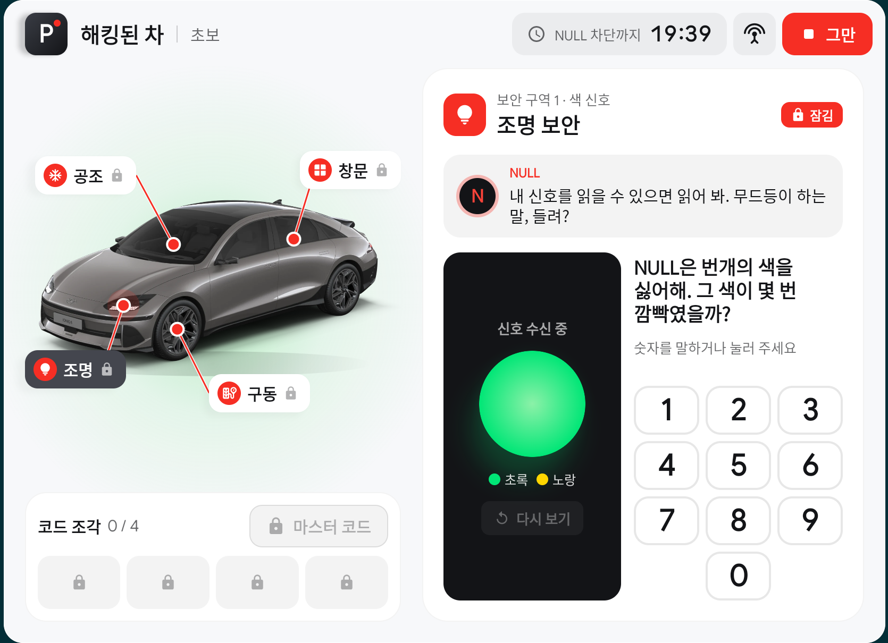
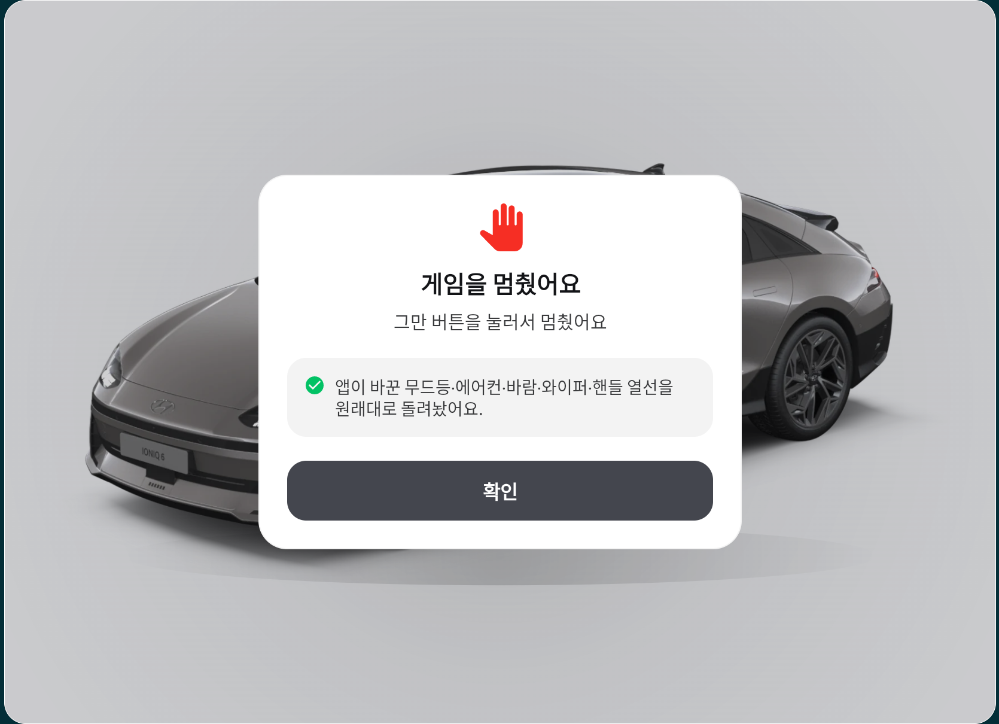
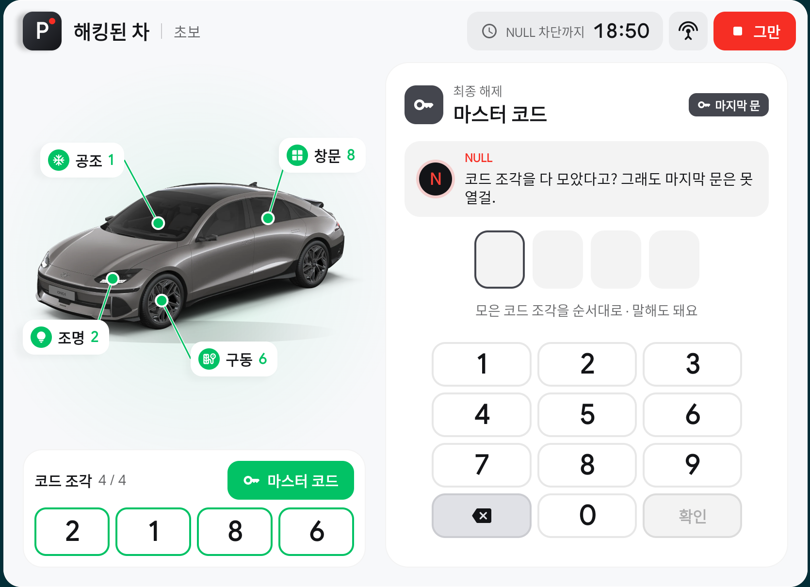
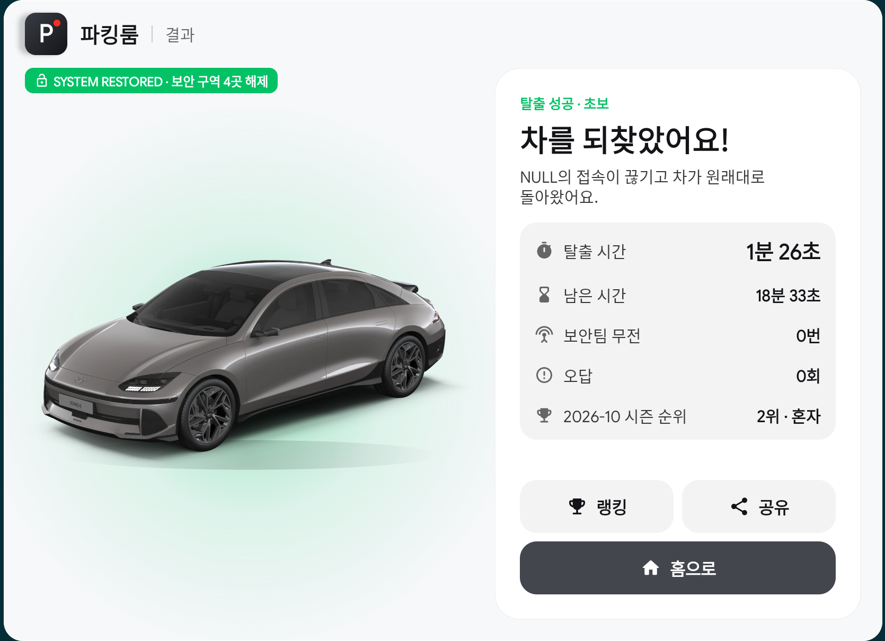

# 파킹룸 (Parking Room)

**주차해 둔 내 차가 해킹당했습니다.** 해커 AI **NULL**이 무드등을 빨갛게 깜빡이고, 찬바람을 틀고, 와이퍼를 흔들어 댑니다. 무드등과 에어컨, 창문, 방향지시등을 직접 만지면서 보안 구역 네 곳의 자물쇠를 풀고, 시간 안에 차를 되찾으면 됩니다.

파킹룸은 Pleos Connect 차량에서 **주차 중에만** 즐기는 차 안 방탈출 게임입니다. 휴대폰 게임처럼 화면만 누르는 게 아니라 차 자체가 컨트롤러가 되고, 연출도 차 전체에서 나옵니다.

<p align="center">
  
  
</p>

| | |
|---|---|
| 플랫폼 | Pleos Connect (Android Automotive OS) |
| 개발 | Kotlin, Jetpack Compose, minSdk 28 / targetSdk 35 |
| 사용 SDK | Pleos Vehicle 2.3.2, TextToSpeech 3.3.1, SpeechToText 3.3.1, AAOS Car API |
| 버전 | v0.3.0 (릴리스 APK: [`apk/TodaysStudio_ParkingRoom_release.apk`](apk/TodaysStudio_ParkingRoom_release.apk)) |
| 출품 | 현대자동차그룹 차량용 앱 개발 공모전 |

---

## 목차

1. [빠르게 해 보기](#1-빠르게-해-보기)
2. [게임 방법](#2-게임-방법)
3. [보안 구역 공략](#3-보안-구역-공략)
4. [난이도](#4-난이도)
5. [안전 장치](#5-안전-장치)
6. [화면 둘러보기](#6-화면-둘러보기)
7. [에뮬레이터에서 차 조작하기](#7-에뮬레이터에서-차-조작하기)
8. [권한](#8-권한)
9. [직접 빌드하기](#9-직접-빌드하기)
10. [코드 구조](#10-코드-구조)
11. [자동 플레이 테스트](#11-자동-플레이-테스트)
12. [자주 묻는 질문](#12-자주-묻는-질문)

---

## 1. 빠르게 해 보기

Pleos Playground 에뮬레이터 기준입니다.

1. Android Studio에서 Pleos Playground 에뮬레이터를 **Cold boot**로 켭니다.
2. APK를 설치합니다.
   ```bash
   adb install -r -g apk/TodaysStudio_ParkingRoom_release.apk
   ```
   다른 서명으로 설치된 파킹룸이 이미 있으면 먼저 지워 주세요: `adb uninstall com.parkingroom.app`
3. 에뮬레이터의 **Virtual Console**에서 차를 주차 상태로 만듭니다.
   - Motion › Gear Selection › **P**
   - Safety › Telltales › **Parking Brake = On**
   - 속도 0
4. 앱 목록에서 **파킹룸**을 실행하고, 난이도와 인원을 고른 뒤 **해킹 대응 시작**을 누릅니다.
5. 처음 실행할 때 뜨는 속도 권한(CAR_SPEED)은 **허용**해 주세요. 음성으로 하고 싶다면 에뮬레이터 Extended controls › Microphone › *Virtual microphone uses host audio input* 을 켜면 됩니다.

> 에뮬레이터는 AAOS 주차 브레이크 값이 항상 꺼짐으로 나와서, 파킹룸은 계기판 주차 브레이크 경고등(Telltale)으로 확인합니다. 그래서 3번에서 Telltale을 켜야 합니다.

## 2. 게임 방법

1. **홈**: 차 그림 위에 잠긴 보안 구역 네 곳(조명, 공조, 창문, 구동)이 보입니다. 난이도와 인원(혼자 / 같이)을 고르고 시작합니다.
2. **안전 확인**: 주차 브레이크, 기어 P, 속도 0을 앱이 알아서 확인합니다. 셋 다 초록색이 되면 시작할 수 있습니다.
3. **해킹 장면**: 화면이 지직거리고 무드등이 빨갛게 깜빡이고, 찬바람이 나오고, NULL이 말을 겁니다.
4. **구역 풀기**: 차 그림에서 구역을 눌러 이동합니다. 순서는 자유입니다. 하나를 풀 때마다 코드 조각 한 자리를 얻습니다.
5. **마스터 코드**: 네 자리가 모이면 마스터 코드 버튼이 열립니다. 말하거나 키패드로 넣으면 끝입니다.
6. **복구 엔딩**: 빨간빛이 빠지고 청록색 무드등, 따뜻한 바람, 와이퍼 인사가 나옵니다. 기록 카드와 이번 달 순위가 뜨고, **공유** 버튼으로 기록을 보낼 수 있습니다.

### 힌트와 목소리

- 오른쪽 위 **무전 버튼**을 누르거나 “힌트”라고 말하면 보안팀이 힌트를 줍니다. 초보는 60초 동안 막혀 있으면 보안팀이 먼저 무전을 겁니다.
- NULL은 남자 목소리, 보안팀은 여자 목소리이고 구역 카드에 자막이 같이 나옵니다.
- 숫자, “힌트”, “그만”은 말로 해도 됩니다.

### 틀리면

벌점 시간이 빠지고(초보 10초, 중급 20초, 상급 30초) **NULL의 반격**이 들어옵니다. 무드등이 번쩍이고 경고음이 울립니다. 게임 중에도 NULL이 70~110초마다 불쑥 끼어들어 방해합니다.

## 3. 보안 구역 공략

| 구역 | 무슨 일이 생기나 | 어떻게 푸나 |
|---|---|---|
| **조명 보안** (색 신호) | 무드등이 여러 색으로 깜빡입니다 | 단서(예: “NULL은 바다색을 싫어해”)에 맞는 색이 몇 번 깜빡였는지 말하거나 누릅니다. 놓쳤으면 *다시 보기* |
| **공조 보안** (온도 금고) | NULL이 찬바람을 세게 틀어 놓습니다 | 화면 금고 다이얼의 온도와 바람 세기를 **차 공조 버튼**으로 맞춥니다. 중급부터는 맞추자마자 NULL이 값을 또 바꿉니다 |
| **창문 보안** (창문 비밀번호) | 막대 네 개가 잠깐 나타났다 사라집니다 | 막대 높이만큼 **실제 창문 네 개**를 엽니다. 같이 하면 각자 자기 창문을 맡으면 편합니다 |
| **구동 보안** (패턴 자물쇠) | 왼쪽, 오른쪽, 브레이크 신호음과 빛이 나옵니다 | 같은 순서로 **방향지시등과 브레이크**를 조작합니다. 라운드마다 길어집니다 |
| **마스터 코드** | 화면이 무너지고 카운트다운 | 모은 네 자리를 입력합니다. 상급은 거꾸로 |

<p align="center">
  
  
</p>
<p align="center">
  
  
</p>

## 4. 난이도

| | 초보 | 중급 | 상급 |
|---|---|---|---|
| 제한 시간 | 20분 | 15분 | 12분 |
| 보안팀 힌트 | 막히면 자동 | 3번 | 1번 |
| 색 신호 | 색 2개 | 색 3개 | 색 4개 |
| 온도 금고 | 한 번 맞추면 끝 | NULL이 1번 바꿈 | NULL이 2번 바꿈 |
| 창문 비밀번호 | 한 칸 차이 허용, 막대 계속 보임 | 정확히, 막대 깜빡임 | 정확히, 막대 1초만 |
| 패턴 자물쇠 | 3 → 4 | 3 → 4 → 5 | 4 → 5 → 6 |
| 마스터 코드 | 순서대로 | 순서대로 | 거꾸로 |
| 오답 벌점 | 10초 | 20초 | 30초 |

색, 숫자, 패턴 단서는 판마다 새로 정해져서 같은 난이도도 매번 답이 다릅니다.

## 5. 안전 장치

차 안 게임이라 안전을 제일 먼저 정했습니다.

- **주차 중에만 시작**: 주차 브레이크 걸림, 기어 P, 속도 0, 주행 규제(UX Restriction) 없음. 넷 다 맞아야 시작 버튼이 눌립니다.
- **바로 멈춤**: 게임 중에 이 중 하나라도 바뀌면 0.2~0.4초 안에 멈춥니다. “그만”이라고 말하거나 오른쪽 위 **그만** 버튼을 눌러도 멈추고, 홈 버튼으로 앱을 벗어나도 멈춥니다.
- **원상 복구**: 멈추거나 끝나면 앱이 바꾼 무드등, 에어컨, 바람, 와이퍼, 핸들 열선을 시작 전 값으로 돌려놓습니다.
- **창문과 문은 안 건드림**: 창문은 사람이 직접 열고 닫습니다. 앱은 창문을 닫거나 문을 잠그지 않습니다. 게임이 끝났을 때 창문이 열려 있으면 닫으라고 알려 줍니다.
- **연출 상한**: 깜빡임은 1초에 3번 이하, 찬바람은 10초 이하, 효과음은 음량 상한이 있습니다. 내비 안내처럼 다른 앱이 소리를 내면 효과음이 줄거나 멈춥니다.

<p align="center">
  
  
</p>

## 6. 화면 둘러보기

| | |
|---|---|
|  마스터 코드 입력 |  틀렸을 때 NULL의 반격 |
|  차를 되찾은 화면. 기록, 순위, 공유 |  다크 모드 (홈, 랭킹, 설정, 게임, 중단) |

- 화면은 Pleos 디자인 가이드의 공식 디자인 에셋 수치(색, 글자, 버튼, 세그먼트, 키패드, 팝업)에 맞춰 만들었고, 차 그림은 Pleos 디스플레이 가이드의 아이오닉 6 렌더를 씁니다.
- 게임 화면의 차 뒤 빛 번짐은 실제 차 무드등 색을 그대로 따라갑니다. 잠긴 구역은 빨강, 푼 구역은 초록입니다.
- 라이트 / 다크 모드는 시스템 설정을 따릅니다.
- **랭킹**(홈 오른쪽 위 트로피): 이 기기 안의 월별 시즌 기록을 난이도, 혼자 / 협동별로 보여 줍니다.
- **설정**(톱니바퀴): 효과음 크기, 앱이 차를 움직이는 범위 안내, 앱 정보.

## 7. 에뮬레이터에서 차 조작하기

게임 중에 실제 차 대신 Virtual Console에서 이렇게 조작하면 됩니다.

| 구역 | Virtual Console |
|---|---|
| 조명 보안 | 조작 없음. 무드등을 보고 숫자를 말하거나 화면 키패드로 입력 |
| 공조 보안 | Climate › Driver Temperature, Fan Speed |
| 창문 보안 | Body › Window FL, FR, RL, RR (10%가 한 칸) |
| 구동 보안 | Body › Turn Signal Left / Right, Motion › Brake |
| 중단 테스트 | Motion › Gear Selection을 D로 바꾸거나 Parking Brake를 Off |

## 8. 권한

실제로 쓰는 것만 넣었습니다.

| 권한 | 쓰는 곳 |
|---|---|
| CAR_POWERTRAIN, CAR_SPEED | 기어 P, 속도 0 확인 (AAOS Car API. CAR_SPEED는 실행 중에 허락받음) |
| CAR_SAFETY, PRIVATE_CAR_SAFETY | 주차 브레이크 경고등 확인 |
| CAR_DRIVE | 브레이크 페달 (패턴 자물쇠) |
| CAR_LIGHTS, CONTROL_CAR_LIGHTS | 방향지시등 읽기, 무드등 색과 밝기 연출 |
| CAR_WINDOWS, CONTROL_CAR_WINDOWS | 창문 위치 읽기(창문 비밀번호), 와이퍼 연출. 창문을 움직이지는 않음 |
| CAR_CLIMATE, CONTROL_CAR_CLIMATE | 공조 온도와 바람(온도 금고, 찬바람 연출), 핸들 열선 |
| TTS_SERVICE, STT_SERVICE | NULL과 보안팀 목소리, 음성 명령 |

## 9. 직접 빌드하기

필요한 것: Android Studio, JDK 17, Android SDK 35. Pleos SDK는 Pleos Playground 메이븐 저장소에서 받아옵니다(`settings.gradle.kts`에 등록돼 있음).

```bash
# 디버그 빌드 (개발자 메뉴의 차량 기능 확인 화면 포함)
./gradlew :app:assembleDebug

# 릴리스 빌드: 프로젝트 루트에 keystore.properties가 있어야 서명됩니다
./gradlew :app:assembleRelease
```

`keystore.properties` 형식 (저장소에는 올리지 않습니다):

```properties
storeFile=keystore/내키.jks
storePassword=...
keyAlias=...
keyPassword=...
```

## 10. 코드 구조

```
app/src/main/
├─ assets/scenarios/hacked_car.json   대사, 난이도, 연출 순서 (새 테마는 이 파일로 추가)
└─ java/com/parkingroom/app/
   ├─ car/
   │  ├─ SafetyMonitor.kt   주차 브레이크·기어·속도·주행 규제 감시, 깨지면 즉시 중단
   │  ├─ CarHub.kt          시작 때 차 설정 저장, 끝나면 복구
   │  ├─ CarSignals.kt      차 상태 읽기 (공조, 창문, 방향지시등, 브레이크 등)
   │  └─ CarActuators.kt    무드등, 공조, 와이퍼, 열선 쓰기
   ├─ engine/
   │  ├─ PuzzleEngine.kt    자물쇠 판정
   │  └─ EffectEngine.kt    4D 연출 (깜빡임, 바람 시간, 음량 상한 내장)
   ├─ voice/VoiceManager.kt TTS 두 화자, STT 명령어
   ├─ audio/                효과음 합성과 재생 (오디오 포커스 처리)
   ├─ game/                 게임 진행과 화면 전환
   ├─ data/RecordStore.kt   기기 안 기록과 월별 랭킹
   └─ ui/                   Compose 화면 (Pleos 디자인 토큰)
```

## 11. 자동 플레이 테스트

Virtual Console의 HTTP API로 차 값을 바꿔 가며 게임을 처음부터 끝까지 자동으로 플레이합니다.

```bash
adb forward tcp:8088 tcp:8088
python -X utf8 tools/game_test/e2e.py <결과폴더>
```

확인하는 것: 기어 D나 브레이크 풀림이면 시작이 안 되는지, 초보와 상급을 끝까지 풀 수 있는지, 오답 벌점과 반격, 기어·브레이크·“그만”으로 바로 멈추는지, 끝난 뒤 차 상태가 시작 전과 같은지.

> Virtual Console은 1초마다 `POST /browser/session` 신호가 없으면 차량 값을 바꾸지 않아서, 스크립트가 이 신호를 알아서 보냅니다.

## 12. 자주 묻는 질문

**시작 버튼이 안 눌려요.** 안전 확인 화면에서 빨간 항목을 보세요. 에뮬레이터라면 Virtual Console의 Telltales › Parking Brake를 On으로 했는지 확인해 주세요.

**무드등이 안 바뀌어요.** Vehicle Control 권한이 있는 환경인지 확인해 주세요. 현재 Pleos Playground에서 Vehicle Control 항목은 준비 중이라, 차를 움직이는 기능은 에뮬레이터에서 확인했습니다.

**음성 인식이 안 돼요.** 에뮬레이터 마이크 설정(1번의 5단계)을 켰는지 확인해 주세요. 말 대신 화면 버튼으로도 전부 할 수 있습니다.

**게임 중에 차를 움직이면요?** 바로 멈추고 바뀐 설정을 원래대로 돌려놓습니다. 다시 하려면 주차 상태로 돌아와서 새로 시작하면 됩니다.

---

© Today's Studio. 차 렌더와 디자인 수치는 Pleos 디자인 가이드의 공식 에셋을 Pleos Connect 앱 제작 목적으로 사용했습니다.
